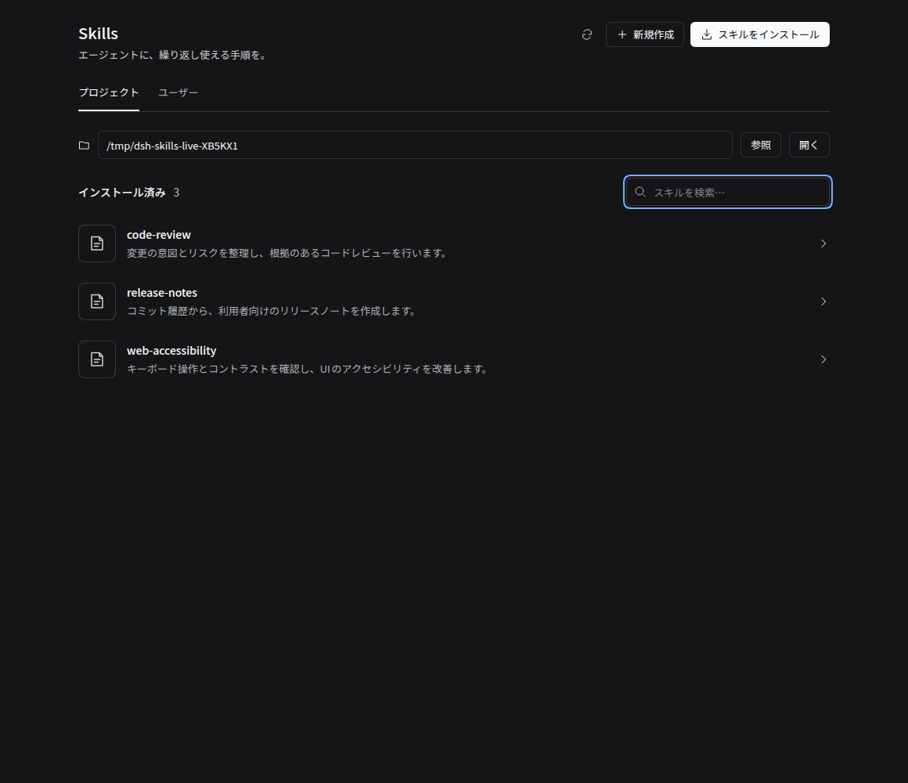
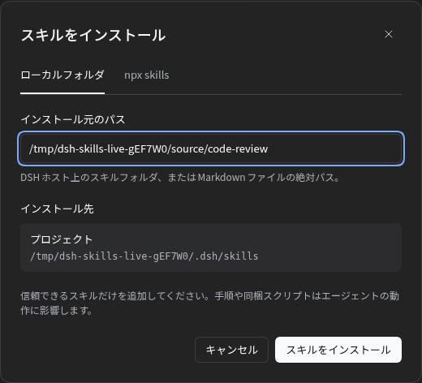
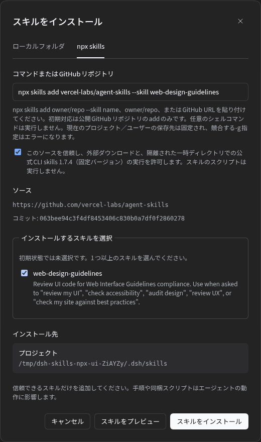
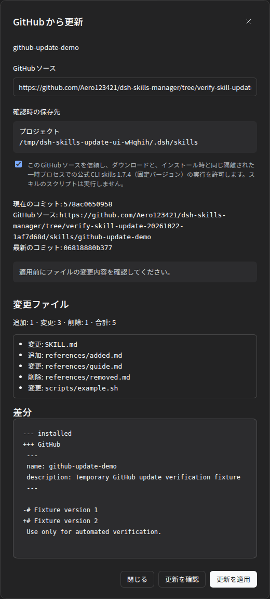

# dsh-skills-manager

Manage [Agent Skills](https://platform.claude.com/docs/en/agents-and-tools/agent-skills/overview) from the DeepSeek Harness sidebar: list, preview, create, edit, delete, enable/disable, validate, install, and update from GitHub — for both **project** (`.dsh/skills`) and **user** (`~/.dsh/skills`) roots.

No build step. Plain Host/Client JavaScript, with pinned `yaml` and official `skills@1.7.4` runtime dependencies. The CLI is used only for an explicitly requested staged installation, never as an arbitrary shell runner.

## Preview

Actual DSH Web screenshots with temporary test skills (not a mock):



<details>
<summary>Install dialog</summary>



</details>

<details>
<summary>npx skills preview and selection</summary>



</details>

<details>
<summary>GitHub update preview</summary>



</details>

## Requirements

- DeepSeek Harness (`dsh`) with a `web`-family profile
- Node.js `^22.20.0 || >=24.0.0` (required by the pinned skills CLI)

## Install

GitHubから直接入れられます（`github:` は `dsh plugin` が受け付ける `pnpm add` 形式です）。

```sh
# 最新の main を入れる
dsh plugin --profile web add github:Aero123421/dsh-skills-manager

# バージョンを固定する（再現性が必要な場合に推奨）
dsh plugin --profile web add github:Aero123421/dsh-skills-manager#v0.6.0
```

インストール後に再起動（または HMR リロード）すると、左サイドバーに **SKILLS** が増えます。

会話中のエージェント経由で入れる場合:

> `plugin_manager` で `install_bundle` を呼び、target に
> `github:Aero123421/dsh-skills-manager`（または `#v0.6.0` 付き）を指定してください。

### Update / Uninstall

**更新前にスキル・旧履歴とDSHプロファイルをバックアップしてください。** 一部環境ではpnpm 12の依存解決失敗時に同一プロファイルの `node_modules` が空になり、他のプラグインも使えなくなる既知のリスクがあります。まず隔離プロファイルでインストールを検証してください。v0.6.0では旧形式の未保存ブラウザ下書きを自動復元しません。必要な下書きは更新前に保存してください。

**v0.2.0以前を使用している場合は、特にスキルをバックアップしてから最新版へ更新してください。** v0.3.0以降には、保存の原子性、同名スキルの識別、更新競合の検出の修正が含まれます。旧版ですでに破損・上書きされた内容を自動復元するものではありません。

```sh
# 更新: いったん外して入れ直し（DSHのgit/tarball更新フロー）
dsh plugin --profile web remove dsh-skills-manager
dsh plugin --profile web add github:Aero123421/dsh-skills-manager#v0.6.0

# 削除
dsh plugin --profile web remove dsh-skills-manager
```

## Use

- 左サイドバーの **SKILLS** から管理画面を開きます。表示言語はDSHの言語設定に追従します（日本語・英語）。
- **プロジェクト** = `<projectRoot>/.dsh/skills`、**ユーザー** = `$DSH_HOME/skills`（未設定なら `~/.dsh/skills`）。
- プロジェクトのパスを入力して **開く**。参照ボタンはHostがディレクトリ選択を提供する環境で利用できます。
- 入力パスは作業ディレクトリとして扱い、DSHと同じく最寄りの `.git` を持つ祖先（worktreeの `.git` ファイルも含む）をプロジェクトルートにします。Git配下でなければ入力先を使います。一覧には解決後の実際の保存先を表示します。旧版でサブディレクトリ直下へ保存したスキルは移動しません。入力したディレクトリの旧 `.dsh/skills` または隣接する `.dsh/skills-manager` が存在する場合は、一覧に旧パスと手動移行の警告を表示します。他のサブディレクトリは検索しないため、旧版で使った各パスを入力して確認してください。旧データと `.dsh/skills-manager` 内の履歴・取得元情報・ジャーナルをバックアップし、復旧待ちがある場合は旧版で復旧した後、必要なフォルダや `.md` をローカルインストールしてください。同名の保存先は上書きせずエラーになります。取得元情報・バックアップは新しい場所へコピーされず、必要ならGitHub取得元を再登録してください。無効なスキルやリンクの移行は手動確認が必要です。
- 一覧は名前・説明で検索できます。クリックすると手順と保存場所、利用設定を表示します。
- **新規作成／編集**でfrontmatterと手順を編集し、形式チェック・保存できます。新規作成は既存の同名スキルを上書きせず、更新・切替・削除は読み込んだ版と一致するときだけ実行します。競合（409）の場合は内容を確認し、再読み込みしてください。
- **エージェントからの利用**は `disable-model-invocation`、**スラッシュコマンド**は `user-invocable` に対応します。未知のmetadataやコメントは保持します。
- **スキルをインストール**の **ローカルフォルダ** タブでは、DSHホスト上のフォルダ（`SKILL.md`入り）または `.md` ファイルを指定します。**npx skills** タブでは公開GitHubのスキルを取得・プレビューして選択できます。同梱リソースもコピーし、既存のインストール先は上書きしません。
- 削除は確認ダイアログを経由し、対象のスキルと同梱ファイルを削除します。
- 未保存の下書きはブラウザのローカルストレージにプロジェクト・形式別で保持します。保存・明示的な破棄で消去します。ストレージが無効または容量不足の場合は保持できません。

画面は公式Plugin Managerの余白・文字サイズ・管理リストのパターンに合わせ、`--dsw-alias-*` のテーマ色を使用しています。Harness内部のClientパッケージへのruntime importや独自の配色テーマはありません。

## `npx skills add` 形式でインストール

1. インストール先の **プロジェクト／ユーザー** を選びます。
2. **スキルをインストール → npx skills** を開き、コマンドを貼り付けます。
3. ソースを確認して信頼確認にチェックし、**スキルをプレビュー** を押します。
4. 候補は初期状態では未選択です。必要なスキルにチェックし、インストールします。

```sh
npx skills add vercel-labs/agent-skills
npx skills add vercel-labs/agent-skills --skill web-design-guidelines
npx -y skills@1.7.4 add https://github.com/vercel-labs/agent-skills --skill web-design-guidelines
# ソースのみの入力も可
vercel-labs/agent-skills
https://github.com/vercel-labs/agent-skills/tree/main/skills/web-design-guidelines
```

- **初期対応は `add` と公開GitHubソースのみ**です。`--skill` / `-s` の複数指定、`'*'`、`--copy`、`-y` / `--yes` に対応します。`#ref` でGit参照を指定できます。
- `-g` / `--global` は画面で **ユーザー** を選んだ場合だけ受け付けます。保存先をコマンドによって勝手に変更しません。
- `--agent`、`--all`、`--package`、任意のCLIバージョン、CLI入力としての `find/update/remove`、GitLab／SSH／private repo、`.git`付きURL、`owner/repo@skill` は未対応で、明示的にエラーにします。スキル更新には下記の **GitHubから更新** UIを使います。CLI全機能の互換を提供するものではありません。
- ローカルパスはローカルフォルダタブで指定してください。入力をシェルへ渡すことはなく、`&&`、パイプ、リダイレクト等は拒否します。
- APIレート制限・巨大／不完全なGitHubツリー・非対応のDSHスキル名・リンクを含むソースは取得できません。ホストのGit／GitHub CLI認証情報を自動利用しません。
- 候補の有効期限は10分です。変更・閉じる・期限切れで破棄します。複数選択の一部が既存名と衝突した場合、成功と失敗を個別に表示します（バッチ全体のトランザクションではありません）。

公式CLIの書式は [Vercel Labs skills](https://github.com/vercel-labs/skills/blob/main/docs/commands.md#skills-add) を参照してください。本プラグインはDSHの検証・保存先に合わせ、上記のサブセットを提供します。

## GitHubからスキルを更新

1. インストール済みの**フォルダ形式**スキルを開き、**GitHubから更新** を押します。上部の一覧再読込ボタンとは別の操作です。
2. 取得元を確認して信頼確認にチェックし、**更新を確認** を押します。
3. 現在／取得先コミット、ファイル・フォルダの追加／変更／削除、`SKILL.md`の差分を確認します。
4. **更新を適用**。変更前のバンドル全体と取得元情報をバックアップしてから、新しい内容へ置き換えます。

### 取得元とローカル編集

- v0.5.0以降のGitHubインストールは、取得元URL・コミット・バンドル全体の基準ハッシュを記録します。更新時は同じスキル名を同じ取得元から再取得します。`#ref`／tree URLの参照は維持し、固定SHAを勝手に最新ブランチへ変更しません。
- **v0.4.0以前のインストールや手動配置では取得元が不明**です。最初に `owner/repo` または公開GitHubのリポジトリ／tree URLを入力して確認してください。名前から取得元を推測しません。
- 既存内容が取得内容と同一なら、ファイルを書き換えず取得元情報だけ登録します（バックアップ不要）。
- 本文・同梱ファイル・空フォルダ・Unix実行権限にローカル変更があれば、別の **ローカル変更をバックアップ後に置き換える** 確認が必要です。利用設定の変更も本文の編集として扱います。自動マージではなくバンドル全体の置換です。
- プレビュー後に本文、リソース、取得元情報が変わった場合、上書き確認済みでも409で拒否します。再確認してください。
- GitHub側の対象ファイルに変更がなければ「上流の更新はありません」と表示し、ローカル編集には触れません。リポジトリ全体のコミットが進んだだけでは、スキル変更と判定しません。
- 差分や一覧が長い場合は省略を明示します。バイナリ／同梱リソースは変更パス・追加／変更／削除の一覧で確認します。すべてのファイル内容をインライン表示するものではありません。

### 履歴・バックアップと制限

取得元・ジャーナル・バックアップはスキルのスキャン対象外へ保存します。

- プロジェクト: `<projectRoot>/.dsh/skills-manager/<name>/`
- ユーザー: `$DSH_HOME/skills-manager/<name>/`（未設定なら `~/.dsh/skills-manager/<name>/`）
- バックアップ: `backups/<UUID>/tree/` に旧バンドル、`origin.json` に旧取得元。旧取得元が未記録ならバックアップ側のJSONは `null` です。

バックアップは自動削除しません。1スキルあたり10件・256MiBを超える更新は元データを動かす前に拒否します。必要なバックアップは退避・整理してください。復元用のGUIボタンは本版にはありません。通常のスキル削除後もバックアップは残します。

置換は同一ファイルシステム上のステージングとジャーナルを使用します。処理中断後は、管理画面の次の一覧／詳細／変更操作で安全に回復できる状態を確認して処理します。曖昧な外部変更があれば元データ・ジャーナルを保持して停止します。読み取り専用のユーザー保存先は勝手に回復書き込みせず、明示的にエラーにします。

これはOSレベルの原子的ディレクトリ交換や、外部プロセスを含む完全なトランザクションではありません。通常のファイルシステム読者には切替途中の短い空白が見える場合があります。更新開始後の接続切断は、適用の取り消しを保証しません。再読込して実際の状態を確認してください。

## Config

`cordis.patch.yml` の row で上書きできます（`dsh profile` の patch 層、または `--patch` オーバーレイで）。

```yaml
- id: dsh-skills-manager
  config:
    allowUserWrite: true   # false にすると user scope は読み取り専用
    allowRemoteInstall: true # false にすると GitHub取得・更新を禁止（ローカル操作は可能）
    maxBodyBytes: 262144   # 1 skill の最大バイト数
```

## API

Host は認証済み `/api` チャネルに exact route を出します（auth + Host/Origin fence は DSH 側で適用済み）。

- `POST /api/dsh-skills-manager/list | get | save | remove | validate | setInvocation | install`
- リモート追加: `prepareRemote` (`input` → `token/source/commit/skills/expiresAt`)、`installRemote` (`token/skillNames` → スキル別結果)、`discardRemote` (`token`)。各リクエストは `scope` と必要な `projectRoot` を指定します。プレビューtokenは保存先に紐付けられ、実際のインストール試行後に消費されます。
- GitHub更新: `prepareUpdate` (`name/kind:'dir'/expectedRevision/source?` → コンテキスト付きtoken・コミット・差分)、`applyUpdate` (`token/name/kind/allowLocalChanges`)、`discardUpdate` (`token`)。`source`は取得元未記録の場合だけ明示指定します。
- `get.update` に更新可否・取得元・バンドル全体の `treeHash`・`originRevision` を返します。不正なリソースや取得元レコードでは更新を無効化して理由を返し、通常の本文確認／修正は可能なままです。ただし未回復・曖昧なトランザクションがある場合はアクセスを停止します。
- JSON: `{ ok: true, value }` / `{ ok: false, error }`
- v0.3.0の変更系APIはv0.2.0と互換ではありません。`list` / `get` が返す `kind` (`dir` / `flat`) と `revision` で対象を識別します。
- 画面は `list` の `root` を以後の操作で `expectedRoot` として送信し、`.git` の追加・削除などで保存先が変わった場合は409で拒否します。直接APIを使う場合も必ず `list` の `root` を `expectedRoot` に設定してください。旧クライアント互換のため省略可能ですが、省略時にこの検査はありません。別プロセスからのファイル操作に対する完全なrace-proof保証ではありません。
- `save`: 新規は `mode: 'create'`、更新は `mode: 'update'` + `kind` + `expectedRevision` が必須です。
- `setInvocation` / `remove`: `kind` + `expectedRevision` が必須です。古い版・存在しない更新対象・作成時の同名衝突は409で拒否します。
- `get`: 同名のフォルダ版・単体版が共存している場合は `kind` を指定してください。曖昧な対象を自動選択しません。

Agent tools（任意、同梱）: `skills_manager_list`、`skills_manager_read`、`skills_manager_validate`

## Skill format

スキャン対象は各 root の直下のみ（1 階層）です。

- ディレクトリ形式: `<root>/<name>/SKILL.md`（+ `references/` `scripts/` `assets/` 可）
- フラット形式: `<root>/<name>.md`

```markdown
---
name: my-skill
description: What this skill does and when to use it.
---

# My skill
...
```

詳細は DSH の `dsh-skill-filesystem` ドキュメントを参照してください。

## Security notes

- このプラグインは認証済みのDSH利用者がHost所有者としてローカルファイルを管理するためのものです。別ユーザー同士を隔離するsandboxではありません。プロジェクトパスは利用者が明示指定します（workspace allowlistへの囲い込みではありません）。
- skill名のパス区切り・`..`・Windows予約名を拒否し、書き込み先とインストール元のsymbolic linkを保守的に拒否します。Host所有者による同時ファイル操作に対する完全なrace-proof保証ではありません。
- frontmatterは実際のYAMLパーサで構文・重複キー・フィールド型を検証します。利用設定の切替では未知のmetadataやコメントを保持し、引用符付きのキーも扱います。
- `allowUserWrite: false` は実際の保存先にも適用します。ユーザー用保存先とプロジェクト用保存先が重なっていても書き込みを許可しません。
- 保存は一時ファイルからの原子的な置換と同名操作の直列化を使用します。`revision` による競合検出は外部エディタ等のあらゆる同時操作を完全にトランザクション化するものではありません。
- リモート取得ではGitHub API／rawの固定ホストへ匿名HTTPS通信します。リダイレクト、リンク、特殊ファイル、危険なパスを拒否し、固定コミットに紐付く通常ファイルだけを取得します。
- その後、固定版 `skills@1.7.4` を `shell:false` のNode子プロセスで**ローカルの検証済みスナップショット**に対して実行します。リモートURLをCLIへ直接渡さず、Git／gh／SSHは呼びません。CLIのtelemetryとcompile cacheは無効化し、実HOME・認証情報・NODE_OPTIONS等を引き継ぎません。
- 実行は90秒、出力256KiB、取得データ32MiB、ツリー／ファイル数にも上限を設けています。取得中の一時領域は64MiB・8192項目を定期チェックします。上限監視はOSレベルの隔離・クォータを保証するsandboxではありません。同時取得は2件、保持プレビューは3件です。
- スキルのスクリプトをインストール時に自動実行しません。ただしスキルの手順は以後のエージェントの動作に影響するため、信頼できるソースだけを追加してください。
- Linux/macOS/Windows向けのpath・改行処理を使用していますが、実機での操作検証は現時点で **Linux + DSH 0.2.1-rc.2** のみです。macOS/Windowsでの実動作確認は未実施です。

## Verification

The v0.5.0 `npm run check` ran **163 tests** covering existing regressions plus verified provenance, complete-tree/origin CAS, preview/overwrite consent, bounded diffs, backups, transaction failure/recovery, committed-with-warning outcomes, stale-source clearing, legacy linking, HTTP compression and fresh branch resolution. Node tests are offline; real public GitHub commit changes and the existing DSH browser are verified separately. See [verification details](docs/verification.md).

[](https://github.com/Aero123421/dsh-skills-manager/actions/workflows/check.yml)

## Development

`npm ci --ignore-scripts` → `npm run check` でHostとClientの回帰テストを実行できます。ビルドは不要です。
`plugin_manager` の `install_bundle`（target = このディレクトリの絶対パス）で開発用 profile に入れて動作確認できます。

2026-10-29の互換性確認では、公式npm配布のDSH `0.2.1-rc.2`（`latest`）、`0.2.1-rc.4`（`next`）、`0.2.2-alpha.2`（`alpha`）の実サービスを使い、保存→native discovery、ツール出力、キャンセル、アンロード後の登録解除と再ロードを確認しました。ブラウザ・認証・モデル呼び出しの試験ではありません。当時のオフライン回帰は168件成功でした。手元に導入済みの公式DSHに対して `DSH_NATIVE_MODULES=/absolute/path/to/node_modules npm run check` を実行すると、追加のnative smokeも実行できます（未指定時はその1件をスキップ）。対象SHAと制限は [verification details](docs/verification.md) を参照してください。

## License

MIT — see [LICENSE](LICENSE).
